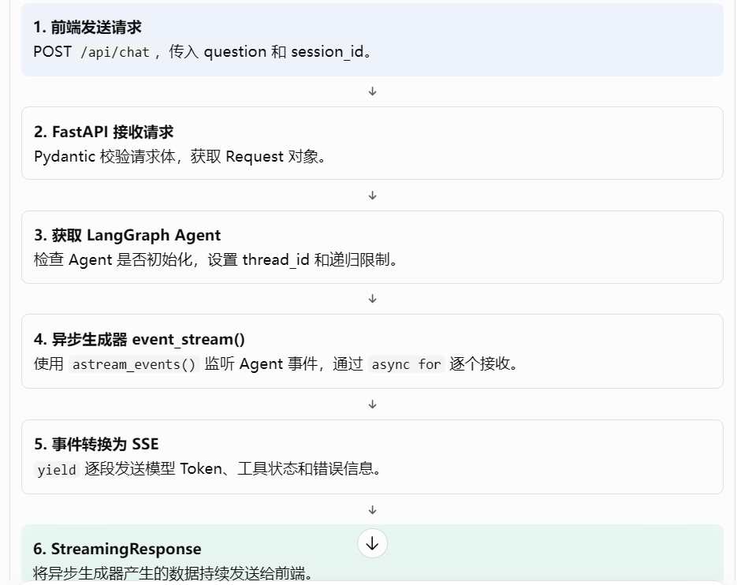

# LangGraph Agent 到前端实时展示的完整技术链路

FastAPI 接收用户问题，然后调用 LangGraph Agent，通过 SSE（Server-Sent Events）把模型生成的内容和工具调用状态实时推送给前端。
astream_events() 负责产生 Agent 事件，async for 负责逐个接收，yield 负责逐段交出数据，StreamingResponse 负责持续发送，SSE 负责规定数据格式。
```python
# @app.post("/api/chat")：注册 POST 接口。
# async def：定义异步路由函数。
# req: AskRequest：接收用户问题和会话 ID。
# request: Request：获取 HTTP 请求上下文
@app.post("/api/chat")
async def chat(req: AskRequest, request: Request):
    """Stream agent tokens and tool activity as Server-Sent Events."""
    agent = getattr(app.state, "agent", None)
    if agent is None:
        raise HTTPException(status_code=503, detail="问答 Agent 未初始化，请检查 MCP 服务配置")
    #构造 LangGraph 配置   1.会话标识,配合 Checkpointer 管理会话状态。 2.递归限制限制 LangGraph 图执行过程中的递归步骤，避免 Agent 不断调用工具或反复推理，导致执行无法正常结束。
    config = {
        "configurable": {"thread_id": req.session_id or str(uuid.uuid4())},
        "recursion_limit": 10,
    }
 #定义 SSE 数据格式化函数  将 Python 字典转换成 SSE 协议要求的文本格式。
    def sse(obj: dict) -> str:
        return f"data: {json.dumps(obj, ensure_ascii=False)}\n\n"  
        #\n\n  SSE 协议规定，一条事件消息以空行结束。
#定义异步生成器 event_stream() 定义它时，并不会立即执行函数体。
    async def event_stream():
        yield sse({"type": "tool", "name": ""})   # 立刻给前端一个"处理中"状态为什么这里用 yield？因为它不是等 Agent 完成后才返回，而是先把一个状态交给响应发送机制。
        # 执行到这里时：1.生成 SSE 字符串。2. 暂停 event_stream()。3.将当前字符串交给外部迭代者。4.等待下一次迭代时继续执行
        try:  
            #调用 agent.astream_events()作用是启动 Agent，并以事件流的形式提供执行过程。
            # 传入的内容：
            #  messages：将用户问题包装成 LangChain 的 HumanMessage。
            # - config：传递会话 ID 和递归限制。
            # - version="v2"：指定 LangGraph 的事件流格式版本。
            # async for    不是等 Agent 全部执行完，再一次性获取所有事件。而是： Agent 产生一个事件。 async for 获取这个事件。 执行循环体，处理当前事件。 等待下一个事件。重复以上过程，直到事件流结束。
            async for event in agent.astream_events(  #监听 LangGraph 的事件流**
                {"messages": [HumanMessage(content=req.question)]},
                config=config,
                version="v2",
            ):
                if await request.is_disconnected():   # 前端点了停止/断开，立即终止
                    break
        # 另外，这段代码是在收到一个 Agent 事件后才检查连接状态。如果 Agent 长时间没有产生新事件，单靠这个检查不能保证立即发现断开。实际断开后的取消和资源清理，还需要结合 ASGI 服务器及 StreamingResponse 的取消处理机制。 
                event_type = event.get("event")
                metadata = event.get("metadata") or {}
             #处理模型生成的 Token   这里有两个条件：1. 当前事件是模型流式输出事件   2. 当前事件来自 LangGraph 的 agent 节点。
                if event_type == "on_chat_model_stream" and metadata.get("langgraph_node") == "agent":
                    chunk = event.get("data", {}).get("chunk")
                    if getattr(chunk, "tool_call_chunks", None):
                        continue                        # 跳过"决定调用工具"那一轮
                    content = getattr(chunk, "content", "")
                    if content:
                        yield sse({"type": "token", "content": content})  #将文本包装成 SSE 消息，通过 yield 交给前端。
                elif event_type == "on_tool_start":
                    yield sse({"type": "tool", "name": event.get("name", "")})
                elif event_type == "on_tool_end":
                    yield sse({
                        "type": "tool_end",
                        "name": event.get("name", "")
                    })
            yield "data: [DONE]\n\n"  #告诉前端：当前 SSE 流已经正常结束。
        except Exception as error:
            yield sse({"type": "error", "content": f"{type(error).__name__}: {error}"})

    return StreamingResponse(
        event_stream(),  #返回的是一个异步生成器对象。
        media_type="text/event-stream",
        headers={
            "Cache-Control": "no-cache, no-transform",
            "Connection": "keep-alive",
            "X-Accel-Buffering": "no",
        },
    )
```
- 异步函数（async def）：允许函数执行过程中挂起，让出执行权。
- 异步生成器（async def + yield）：可以分多次产生数据，每次产生一部分，后续还能继续执行。
- 流式响应（StreamingResponse + SSE）：不必等 Agent 全部执行完毕再返回，而是生成一段就发送一段。
  
| 对比     | return       | yield              |
| -------- | ------------ | ------------------ |
| 返回方式 | 一次返回结果 | 分多次产生结果     |
| 函数状态 | 返回后结束   | 暂停并保留执行状态 |
| 后续执行 | 不会继续     | 再次迭代时继续     |
| 典型用途 | 普通函数     | 逐步产生数据       |

异步生成器函数:在普通生成器的基础上，增加 async
它有两个特点：
- 使用 yield 分批产生数据。
- 使用异步迭代方式消费数据。
异步生成器尤其适合需要等待网络响应、数据库结果或模型输出的场景。
异步生成器调用时返回异步生成器对象，开始异步迭代后才执行函数体。
yield 用于产生数据；await 用于等待可等待对象完成。
agent.astream_events(...)LangGraph 提供的异步事件流接口。使用 async def 可以通过 async for 异步消费事件，不需要阻塞等待每个事件产生。

异步不等于流式，流式也不等于异步。
- 异步：解决等待过程中如何让出执行权的问题。
- 生成器：解决如何分批产生数据的问题。
- 流式响应：解决如何将分批产生的数据持续发送给客户端的问题。
- SSE：规定服务器推送的数据格式和传输方式。

你的 FastAPI 项目是如何实现 Agent 流式输出的？
我的项目使用 FastAPI 的 StreamingResponse 实现 Agent 的流式问答。
首先，接口接收用户问题和 session_id，获取已经初始化的 LangGraph Agent，并构造会话配置。
然后定义一个异步生成器 event_stream，内部通过 agent.astream_events() 异步监听 Agent 的执行事件。
对于模型生成事件，我提取其中的文本 chunk，通过 yield 转换成 SSE 格式发送给前端；对于工具调用事件，则推送工具名称和执行状态。
最后，将这个异步生成器交给 StreamingResponse，并设置 text/event-stream 类型。这样 Agent 每产生一段内容，后端就可以将其推送给前端，不需要等待整个回答生成完成。

建议记住下面这张表：
| 知识点            | 一句话理解                        |
| ----------------- | --------------------------------- |
| 异步函数          | `async def` 定义，可以使用 await  |
| 异步生成器        | `async def + yield`，分批产生数据 |
| await             | 等待异步操作，不阻塞事件循环      |
| async for         | 逐个异步获取数据                  |
| StreamingResponse | 将生成器的数据持续发送给客户端    |
| SSE               | 服务器向客户端推送事件的数据格式  |
| Pydantic          | 定义请求数据结构并校验            |
| Request           | 获取 HTTP 请求上下文              |
| app.state         | 保存应用级共享状态                |
| thread_id         | 标识 LangGraph 会话               |
| SQLite            | 保存结构化业务数据                |
| Chroma            | 保存向量及检索相关数据            |
| commit            | 提交事务                          |
| rollback          | 回滚未提交事务                    |

面试时可以这样概括你的项目：
我的项目使用 FastAPI 提供问答接口，通过 Pydantic 校验用户请求，获取预初始化的 LangGraph Agent。后端使用 astream_events() 异步监听 Agent 的模型输出和工具调用事件，通过异步生成器 yield 将事件转换为 SSE 格式，再交给 StreamingResponse 持续发送给前端，实现实时文本展示和工具状态反馈。底层使用 SQLite 保存新闻业务数据，Chroma 保存 Embedding 向量，LangGraph 配合 Checkpointer 管理会话状态。

这段代码最值得掌握的是：异步生成器、SSE、StreamingResponse、FastAPI 参数注入，以及 LangGraph 会话状态管理。 数据库部分重点掌握 SQLite 和 Chroma 的职责划分、事务和失败重试。

## 一次 AI 对话的完整调用流程

例如用户在前端输入：
今天有哪些值得关注的大模型新闻？

调用过程：
1. 用户交互：用户在 Next.js 聊天页面输入问题。
2. 前端调用：页面调用 services/chat.ts 中封装的请求函数。
3. HTTP 请求：前端通过 HTTP POST 请求 FastAPI 后端。
4. 后端接收：FastAPI API Router 接收请求并解析参数。
5. 业务处理：后端调用对应的 Service 处理业务逻辑。
6. Agent 推理：LangGraph Agent 分析用户问题，判断需要调用哪些工具。
7. MCP 工具调用：Agent 根据需要调用 MCP Server 提供的工具，例如：
   - search_news
   - search_news_semantic
   - get_daily_report
   - request_daily_report
8. 数据检索：工具访问 SQLite 或 Chroma，获取新闻数据或向量检索结果。
9. 生成回答：Agent 根据检索结果组织回答，并附带新闻引用来源。
10. 返回前端：FastAPI 将结果转换为 JSON 返回。
11. 页面渲染：Next.js 接收响应，在聊天窗口展示回答及新闻引用。
    
