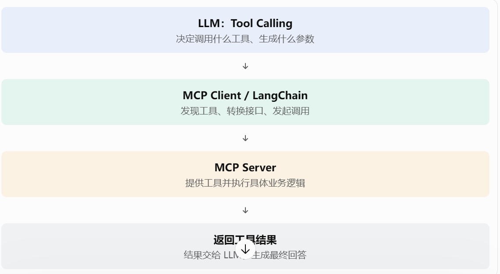

# Day 7｜LLM Tool Calling

## 技术面试回答结构

1. 定义：它是什么？用自己的话解释概念
2. 目的：为什么需要它？理解它解决什么问题
3. 原理：它内部怎么工作？理解核心机制
4. 实践：我在项目中怎么使用？
5. 取舍：有什么局限，为什么选择它？

## 一、学习内容与记录

### 1. 普通 LLM 调用与 Tool Calling 的区别

**定义：**

普通 LLM 调用是将用户问题发送给模型，由模型**直接生成文本答案**。
Tool Calling（工具调用）是模型根据用户需求，决定是否调用外部工具，并**生成符合工具定义的调用信息**，由应用程序执行工具，再将执行结果交给模型。

**目的：**

普通 LLM 主要依靠模型**自身的知识和推理能力**回答问题。
但模型无法直接访问应用程序中的数据库、文件和外部 API。
Tool Calling 可以让模型**调用外部能力**，扩展其实际操作范围。

例如：

```text
用户：查询今天的大模型新闻有哪些？

普通 LLM：
根据自身知识直接生成回答。

Tool Calling：
模型决定调用 search_news 工具
→ 应用程序执行数据库查询
→ 返回新闻结果
→ 模型组织最终答案
```

**原理：**

普通 LLM：
```text
用户问题
  ↓
LLM
  ↓
文本答案
```
Tool Calling：
```text
用户问题
  ↓
LLM 判断是否需要工具
  ↓
返回工具调用请求
  ↓
应用程序执行工具
  ↓
工具执行结果返回模型
  ↓
LLM 生成最终答案
```
关键区别是：模型通常**只负责提出工具调用请求**，真正执行 Python 函数、数据库查询或 API 请求的是**应用程序**。

**实践：**

AI 资讯项目使用 LangGraph 构建单 Agent + Tool Calling 工作流。
Agent 可以根据用户问题调用新闻搜索、语义检索和日报相关工具。
例如用户询问：
```text
搜索最近的大模型新闻。
```
Agent 可以选择调用 `search_news` 或 `search_news_semantic`，而不是直接让模型凭已有知识回答。

**局限与取舍：**

普通 LLM 调用简单、延迟较低，适合不需要外部数据的任务。

Tool Calling 可以访问外部系统，但会增加：
- 工具执行时间。
- 工具调用失败的可能性。
- 参数校验和权限管理成本。
- 整体流程的复杂度。

### 2. 模型如何判断是否调用工具？

**定义：**

模型会根据用户问题、系统提示词和工具描述，判断是否需要使用工具，并选择适合的工具。
这里的“判断”是**模型基于上下文生成的结果**，不是程序内部提前写死的所有业务判断。

**目的：**
让 Agent 根据任务动态选择外部能力，而不是所有请求都使用同一个固定工具。
例如：

| 用户问题 | 可能选择的工具 |
|---|---|
| 搜索最近的 AI 新闻 | `search_news` |
| 找语义相关的 Agent 新闻 | `search_news_semantic` |
| 查看某天的日报 | `get_daily_report` |
| 生成某天的日报 | `request_daily_report` |

**原理：**

应用程序向模型提供工具定义，包括：
- 工具名称。
- 工具描述。
- 参数名称。
- 参数类型。
- 必填参数等。

模型根据这些信息生成普通文本回答或工具调用请求。
工具描述越清晰，模型越容易区分不同工具的用途。

例如：

```python
tools = [
    {
        "type": "function",
        "function": {
            "name": "search_news",
            "description": "根据关键词搜索新闻",
            "parameters": {
                "type": "object",
                "properties": {
                    "keyword": {
                        "type": "string",
                        "description": "新闻搜索关键词"
                    }
                },
                "required": ["keyword"]
            }
        }
    }
]
```
**实践：**
项目中有多个新闻相关工具。
例如：
- `search_news`：根据关键词检索新闻。
- `search_news_semantic`：根据语义检索新闻。
- `get_daily_report`：查询已有日报。
- `request_daily_report`：请求生成日报。

Agent 根据用户问题选择对应工具。
需要注意：工具选择并不是绝对可靠的，仍然需要通过测试集评估模型是否选对工具。

**局限与取舍：**

模型可能：
- 选择错误的工具。
- 不调用本应调用的工具。
- 同时调用多个不必要的工具。
- 生成错误参数。

因此需要通过清晰的工具描述、Prompt 约束、参数校验和评估机制提高可靠性。

### 3. Tool Schema、参数生成和参数校验

**定义：**

Tool Schema 是**工具的结构化定义**，描述**工具名称、功能和输入参数**。
/ˈskiːmə/
模型根据 Schema 生成工具调用参数，应用程序需要进一步校验参数是否合法。

**目的：**

让模型知道：
- 有哪些工具可以使用。
- 每个工具负责什么任务。
- 调用工具需要提供哪些参数。
- 参数的数据类型和约束是什么。

**原理：**

以新闻搜索工具为例：
```python
def search_news(keyword: str, limit: int = 10):
    """
    根据关键词搜索新闻。
    """
    return []
```
对应的工具参数 Schema：
```json
{
  "type": "object",
  "properties": {
    "keyword": {
      "type": "string"
    },
    "limit": {
      "type": "integer",
      "minimum": 1,
      "maximum": 100
    }
  },
  "required": ["keyword"]
}
```
模型可能生成：
```json
{
  "keyword": "大模型",
  "limit": 10
}
```

应用程序解析参数后，还需要检查参数是否合法，再调用实际函数。

需要区分：
- Schema 告诉模型应该如何组织参数。
- 参数校验保证输入符合程序要求。
- 业务校验保证参数在实际业务中合理。

**实践：**

项目中的新闻工具需要接收关键词、日期、数量等参数。

例如：

```python
from pydantic import BaseModel, Field

class NewsSearchInput(BaseModel):
    keyword: str = Field(min_length=1)
    limit: int = Field(default=10, ge=1, le=100)

def search_news_tool(args: dict):
    params = NewsSearchInput.model_validate(args)

    return search_news(
        keyword=params.keyword,
        limit=params.limit
    )
```

这样可以避免直接信任模型生成的参数。

**局限与取舍：**
Schema 可以约束参数格式，但不能保证参数在业务上一定正确。
例如日期格式正确，不代表数据库中一定有这一天的日报。
因此还需要业务逻辑检查和异常处理。

### 4. 工具执行结果如何返回给模型？

**定义：**

工具执行结果是外部函数或服务返回的数据。

应用程序需要将**工具执行结果作为工具消息**返回给模型，让模型基于结果继续生成回答。

**目的：**

模型本身不直接执行工具，只有拿到实际执行结果，才能根据外部数据生成最终答案。

**原理：**

一次完整的工具调用通常包含以下步骤：

1. 用户发送问题。
2. 模型返回工具调用请求。
3. 应用程序解析工具名称和参数。
4. 应用程序执行对应函数。
5. 工具返回执行结果。
6. 应用程序将结果以工具消息的形式交给模型。
7. 模型生成最终回答。

示意代码：

```python
messages = [
    {"role": "user", "content": "搜索大模型新闻"}
]
# 第一次调用模型
response = call_llm(messages, tools=tools)
# 获取模型返回的工具调用
tool_call = response.tool_calls[0]
# 执行实际工具
result = search_news(
    keyword="大模型",
    limit=10
)

# 将工具调用和结果加入对话
messages.append(response.assistant_message)
messages.append({
    "role": "tool",
    "tool_call_id": tool_call.id,
    "content": json.dumps(result, ensure_ascii=False)
})
# 再次调用模型生成最终答案
final_response = call_llm(messages, tools=tools)
```

这里是简化示例。实际调用需要根据模型服务商的消息结构处理工具调用 ID、参数解析和错误情况。

**实践：**

项目中，Agent 调用新闻检索工具后，工具会返回检索到的新闻数据。
Agent 再根据这些数据组织自然语言回答。
例如工具返回：
```json
[
  {
    "title": "某大模型发布新版本",
    "source": "示例新闻源",
    "published_at": "2026-11-03"
  }
]
```
Agent 可以基于返回的新闻标题、来源和时间生成回答。

**局限与取舍：**

工具结果可能：
- 数据量过大。
- 包含无关内容。
- 格式不统一。
- 包含异常或错误信息。

因此工具返回值应尽量结构化、精简，并对异常情况进行明确处理。

### 5. 多个工具如何选择？

**定义：**
当 Agent 可以使用多个工具时，需要根据用户任务选择合适的工具，必要时还需要决定调用顺序。

**目的：**
不同工具承担不同职责。
合理的工具选择可以减少无效调用，提高任务完成效率和回答准确性。

**原理：**

例如：

```text
用户：今天有哪些重要的 AI 新闻？

Agent
  ↓
判断需要查询新闻
  ↓
选择 search_news
  ↓
获取新闻结果
  ↓
组织答案
```
如果用户问：
```text
最近一周 AI Agent 领域有哪些值得关注的事件？
```

可能需要：
1. 使用语义检索获取相关新闻。
2. 根据发布时间过滤结果。
3. 对结果进行归纳。
4. 返回带来源的回答。

工具选择主要受以下因素影响：
- 用户问题的意图。
- 工具的名称和描述。
- 参数定义。
- 当前对话上下文。
- 系统提示词中的约束。

**实践：**

项目中有四个主要 MCP 工具：

| 工具 | 主要职责 |
|---|---|
| `search_news` | 新闻关键词检索 |
| `search_news_semantic` | 新闻语义检索 |
| `get_daily_report` | 查询已有日报 |
| `request_daily_report` | 请求生成日报 |

可以通过测试不同类型的问题，检查 Agent 是否选择正确工具。

例如：
- “搜索大模型新闻”应该考虑新闻检索工具。
- “找一些与 RAG 相关的新闻”应该考虑语义检索工具。
- “查看 2026-11-03 的日报”应该查询日报。
- “生成 2026-11-03 的日报”应该请求日报生成。

**局限与取舍：**

工具数量越多，不一定意味着 Agent 能力越强。
工具职责重叠、描述不清晰时，模型更容易选错。

因此需要：
- 控制工具数量。
- 明确工具边界。
- 保持参数定义一致。
- 通过评估集测试工具选择准确性。
- 对高风险操作增加权限和人工确认。
### 6. Function Calling 和 Tool Calling 有什么区别？
Function Calling 和 Tool Calling 本质上都是让大模型通过结构化请求调用外部功能。主要区别在于：Function Calling 更强调调用函数，Tool Calling 是更广义的工具调用机制。
**核心区别**

| 对比     | Function Calling   | Tool Calling                |
| -------- | ------------------ | --------------------------- |
| 含义     | 函数调用机制       | 工具调用机制                |
| 调用对象 | 通常是一个函数     | 函数、API、数据库查询等工具 |
| 模型职责 | 生成函数名称和参数 | 选择工具并生成调用参数      |
| 执行者   | 应用程序           | 应用程序或工具执行框架      |
| 范围     | 相对具体           | 更广泛，通常包含函数调用    |
需要注意：在现代大模型 API 中，两者的术语经常混用，并不是严格对立的两套技术
**Function Calling 是什么？**
Function Calling 强调：模型根据用户需求，生成一个结构化的函数调用请求，由应用程序执行函数。
**Tool Calling 是什么？**
Tool Calling 是更广义的工具调用能力。
工具不一定只是一个普通 Python 函数，还可以是：
- 数据库查询工具
- HTTP API 工具
- 文件读取工具
- MCP Server 提供的工具
- 搜索引擎工具
  
> Function Calling 和 Tool Calling 本质上都是大模型调用外部功能的机制。Function Calling 更强调模型生成结构化的函数调用请求，由应用程序执行对应函数。Tool Calling 是更广义的工具调用能力，除了普通函数，还可以调用 API、数据库查询以及 MCP 提供的工具。
> 在我的项目中，使用 LangChain 将 Python 函数和 MCP 工具统一封装为 Tool，通过 tools=TOOLS 提供给模型。模型根据用户意图生成 Tool Call，再由 LangGraph 的 ToolNode 执行，最后将结果返回模型生成回答。
Function Calling 和 Tool Calling 是模型本身的能力吗？
是的，主要是模型及其 API 提供的能力。
模型经过训练，能够根据用户问题和工具描述：
1. 判断是否需要调用工具。
2. 选择合适的工具。
3. 根据工具 Schema 生成参数。
4. 输出结构化的 Tool Call 请求。
但要注意：模型只负责生成调用请求，不负责真正执行工具。
MCP 是一种标准化的**工具接入和通信协议**。
它主要解决的问题是：不同工具的接口和接入方式不统一，导致每接入一个工具，都可能需要单独开发适配逻辑。
MCP 通过**统一的协议约定**，让 MCP Client 能够**发现工具、获取工具描述和参数 Schema**，并调用 MCP Server 提供的工具。


Tool Calling 是大模型提供的一种工具调用能力，模型能够根据用户意图和工具描述，选择工具并生成结构化的调用请求，但实际执行由外部应用程序完成。
MCP 是一种标准化的工具接入和通信协议，它统一了工具的发现、描述和调用方式，让大模型应用能够更方便地接入不同来源的工具。
两者并不冲突：Tool Calling 负责决策，MCP 负责工具接入和通信，应用程序负责调度和执行。
## 二、实践任务

- [ ] 找到项目中的 `search_news`、`search_news_semantic` 等工具。
- [ ] 跟踪一次完整的工具调用。
- [ ] 自己写一个简单的 Python 工具调用流程。
- [ ] 找到模型返回工具调用请求的代码。
- [ ] 找到工具执行结果返回模型的代码。
- [ ] 思考关键词检索和语义检索分别适合什么问题。


## 三、学习复盘

**今天还没搞懂的内容：**

- 模型返回的 Tool Call 究竟是什么？它是已经执行的函数，还是一条等待应用程序处理的调用请求？
  Tool Call 是模型生成的一条结构化工具调用请求，不是已经执行的 Python 函数。
  执行过程分为两个阶段：
  1. 模型阶段：模型生成 Tool Call，表达调用意图。
  2. 应用程序阶段：应用程序解析 Tool Call，找到对应工具，传入参数并执行。
   
- 模型如何根据工具描述和用户问题选择工具？工具描述不清晰时会出现什么问题？
  模型通过理解用户意图，并结合工具名称、描述和参数 Schema，判断哪个工具最适合完成当前任务。
  模型主要根据用户意图与工具描述进行匹配，因此工具设计时要保证名称清晰、职责单一、描述明确，尽量避免多个工具功能重叠。我会结合 Prompt 明确使用场景，并通过工具选择评估集检查模型是否选择正确。

- Tool Schema 中的参数约束是否等于真正的参数校验？为什么应用程序还需要进行二次校验？
  不等于。Schema 主要用于约束模型生成的参数结构，不能完全替代应用程序的业务校验。
  Tool Schema 可以约束参数名称、类型和必填属性，帮助模型生成符合要求的调用请求，但不能完全保证业务参数合法。因此应用程序仍然需要进行二次校验，例如日期格式、数据范围、权限和任务状态检查，避免错误参数影响实际业务。


- 工具执行结果为什么需要重新传给模型？工具返回结果后，模型是否一定会再次调用工具？
  工具执行结果需要返回模型，是为了让模型获得真实数据，并基于数据生成回答。模型不一定会再次调用工具。
工具本身通常只负责完成具体任务并返回数据，不负责生成面向用户的完整回答。因此需要将 ToolMessage 重新传给模型，由模型理解结果并决定是直接回答还是继续调用其他工具。

- 如果模型连续调用多个工具，应用程序如何管理调用顺序和结果？
  通过工具调用 ID、消息状态和工作流编排管理工具调用及执行结果
  如果多个工具之间没有依赖关系，可以并行执行，提高效率；如果存在数据依赖，则需要按照执行顺序串行调用。我使用 LangGraph 的条件路由和 Send 将搜索工具与日报工具分组调度，并通过消息状态和 tool_call_id 管理调用请求与返回结果。

- 如果工具执行超时、返回空数据或抛出异常，Agent 应该如何处理？
  我会根据不同异常设计不同处理方式。对于超时设置时间限制和重试机制；对于空结果明确返回无数据状态；对于执行异常捕获并记录日志。同时将错误信息返回模型，让 Agent 判断是否需要调整参数、重新调用或者向用户说明失败。对于有副作用的工具，还需要考虑幂等性，避免重试造成重复操作。
工具超时	设置超时时间，必要时重试或返回超时信息
返回空数据	明确告知模型没有检索到结果，不要编造数据
参数错误	返回参数错误信息，必要时让模型重新生成参数
工具执行异常	捕获异常，记录日志，返回可理解的错误信息
服务不可用	重试、降级或切换备用服务

- 模型选择了错误工具时，应该通过 Prompt、工具描述还是程序逻辑进行修正？
  我会先判断错误来源。如果是模型对工具使用场景理解不清楚，通过 Prompt 明确选择规则；如果是工具职责重叠，优化工具名称和描述；如果涉及业务约束，则通过程序逻辑强制校验。最后通过评估集验证修改是否真正改善了工具选择准确率。

- Tool Calling 和 MCP 分别解决什么问题？为什么 MCP 不是 Tool Calling 的替代品？
 Tool Calling 解决模型如何选择和发起工具调用的问题，MCP 解决工具如何被 AI 应用统一发现、接入和通信的问题。 
 Tool Calling 是模型层面的工具调用能力，负责根据用户意图选择工具并生成参数；MCP 是工具接入和通信协议，负责让不同 AI 应用以统一方式发现和使用外部工具。两者可以结合使用，MCP 并不负责模型决策，因此不能替代 Tool Calling。

**需要面试前回顾的内容：**

- 普通 LLM 调用和 Tool Calling 的区别。
  | 对比         | 普通 LLM 调用      | Tool Calling                    |
| ------------ | ------------------ | ------------------------------- |
| 输入         | 用户问题 + Prompt  | 用户问题 + Prompt + Tool Schema |
| 模型输出     | 文本回答           | 文本或结构化工具调用请求        |
| 外部数据     | 通常依赖输入上下文 | 可以通过工具获取                |
| 执行外部操作 | 不会自动执行       | 应用程序执行工具                |
| 典型用途     | 总结、翻译、问答   | 搜索、查询数据库、调用 API      |

- Tool Calling 的完整执行过程：模型生成调用请求 → 应用程序解析参数 → 执行工具 → 返回结果 → 模型生成最终回答。
- Tool Schema 的作用，以及工具名称、描述、参数类型和必填参数的定义。
- 模型负责生成调用请求，应用程序负责真正执行工具。
- 工具结果如何通过 Tool Message 返回模型。
- 多工具选择的依据，以及如何减少工具职责重叠。
- Tool Calling、MCP 和 LangGraph 的职责区别。
- 结合项目说明 `search_news`、`search_news_semantic`、`get_daily_report` 和 `request_daily_report` 的职责及选择场景。
- 如果模型没有选择正确工具，如何通过评估集检查工具选择准确率和调用成功率？
我会建立一套固定的工具调用评估集，覆盖不同工具选择场景、参数边界和异常情况。通过 Tool Selection Accuracy、Tool Success Rate 和 Task Completion Rate 等指标，区分模型决策问题、工具执行问题和任务完成问题。发现问题后针对性优化 Prompt、Tool Schema 或程序逻辑，并通过回归测试验证效果。

## 2. Tool Calling 完整执行过程
1. 模型生成调用请求
   根据用户问题和 Tool Schema 选择工具，生成工具名称和参数。
2. 应用程序解析请求
   读取 tool_calls，识别工具名称和参数。
3. 参数校验和工具分发
   校验参数，找到对应的工具执行函数。
4. 执行工具
   查询数据库、调用 API 或执行其他业务逻辑。
5. 返回工具结果
   将结果封装成 ToolMessage，并通过 tool_call_id 关联调用请求。
6. 模型再次处理
   模型根据结果决定继续调用工具，还是直接生成最终回答。
记忆口诀：模型决策 → 程序执行 → 结果反馈 → 模型回答。

## 3. Tool Schema 的作用
Tool Schema 描述工具的接口信息，让模型知道工具的用途和调用方式。
主要包含：

| 字段        | 作用               |
| ----------- | ------------------ |
| name        | 工具名称           |
| description | 工具功能及使用场景 |
| parameters  | 参数定义           |
| type        | 参数类型           |
| required    | 必填参数           |

例如：
```
@toolasync def search_news(    query: str,    limit: int = 10,) -> str:    """根据关键词搜索新闻"""
```
模型可以据此理解：

- 工具名称：`search_news`
- 功能：根据关键词搜索新闻
- `query`：必填字符串
- `limit`：可选整数，默认 10

Schema 的核心作用是让模型知道如何正确调用工具，同时提高调用参数的结构化程度。

## 4. 模型和应用程序分别负责什么？

| 模型负责             | 应用程序负责       |
| -------------------- | ------------------ |
| 理解用户意图         | 注册工具           |
| 选择工具             | 接收 Tool Call     |
| 生成调用参数         | 参数校验           |
| 判断是否需要继续调用 | 执行工具           |
| 根据结果组织回答     | 错误处理和结果返回 |

这是 Tool Calling 最重要的职责边界。

## 5. Tool Message 如何返回模型？

模型生成 Tool Call 后，应用程序执行工具，并将结果封装为 ToolMessage。
例如：
```
ToolMessage(    content="找到 5 条相关新闻",    tool_call_id="call_123",    name="search_news",)
```
其中 `tool_call_id` 用于关联原始工具调用。
LangGraph 将工具执行结果写入消息状态，再通过边返回 Agent 节点。
你的代码：
```
g.add_edge("tools_search", "agent")g.add_edge("tools_report", "agent")
```
就是实现这一过程。

## 6. 如何减少多工具职责重叠？

建议从四个方面设计：

1. 职责单一：一个工具解决一个明确问题。
2. 描述清晰：明确工具能做什么、不能做什么。
3. 参数明确：尽量减少含义模糊的参数。
4. 场景区分：在 System Prompt 中说明工具选择规则。

你的项目可以这样区分：

| 工具                   | 职责         | 典型问题                   |
| ---------------------- | ------------ | -------------------------- |
| `search_news`          | 关键词检索   | 搜索 OpenAI 新闻           |
| `search_news_semantic` | 语义检索     | 查找讨论 AI 推理优化的新闻 |
| `get_daily_report`     | 读取日报     | 查看 2026-11-07 的日报     |
| `request_daily_report` | 后台生成日报 | 重新生成 2026-11-07 的日报 |

特别注意：`get_daily_report` 是读取，`request_daily_report` 是生成，不能混淆。

## 7. Tool Calling、MCP 和 LangGraph 的职责区别

| 技术         | 所属层次     | 核心职责                     |
| ------------ | ------------ | ---------------------------- |
| Tool Calling | 模型交互层   | 模型选择工具、生成参数       |
| MCP          | 工具通信层   | 统一工具发现、接入和通信     |
| LangGraph    | 工作流编排层 | 状态管理、条件路由、循环执行 |
| ToolNode     | 工具执行层   | 实际执行注册的工具           |

# 三、工具选择评估：如何证明 Agent 真的会使用工具？

## 1. 为什么需要评估？
Tool Calling 并不是模型能够生成 Tool Call 就代表实现成功。
还需要判断：
- 是否选择了正确的工具？
- 是否生成了正确的参数？
- 工具是否成功执行？
- 是否完成了用户任务？
- 最终回答是否正确？
因此，需要建立工具调用评估集。

## 2. 如何设计评估集？

可以设计 30 个测试问题，覆盖四种工具和异常情况。

| 测试类型     | 示例问题                   | 预期行为                           |
| ------------ | -------------------------- | ---------------------------------- |
| 关键词检索   | 搜索 OpenAI 新闻           | `search_news`                      |
| 语义检索     | 查找讨论 AI 推理优化的新闻 | `search_news_semantic`             |
| 日报读取     | 查看昨天的日报             | `get_daily_report`                 |
| 日报生成     | 生成指定日期的日报         | `request_daily_report`             |
| 强制重新生成 | 重新生成某天的日报         | `request_daily_report(force=True)` |
| 日期异常     | 查询不存在的日期格式       | 参数校验失败                       |
| 空结果       | 搜索不存在的主题           | 返回无数据                         |
| 工具异常     | 模拟 MCP Server 不可用     | 错误处理                           |
| 多工具调用   | 搜索新闻并读取日报         | 根据任务决定是否调用多个工具       |
| 无需工具     | 解释什么是强化学习         | 直接回答                           |

建议每种工具至少设计 5 个测试用例，再增加异常和边界测试。

## 3. 重点评估指标

| 指标                    | 计算方式                        | 衡量内容       |
| ----------------------- | ------------------------------- | -------------- |
| Tool Selection Accuracy | 正确工具选择次数 / 测试总次数   | 工具选择准确率 |
| Tool Success Rate       | 成功执行次数 / 实际调用次数     | 工具执行成功率 |
| Task Completion Rate    | 成功完成任务数 / 测试总数       | 任务完成率     |
| Parameter Accuracy      | 正确参数调用次数 / 参数评估次数 | 参数准确率     |
| Citation Accuracy       | 引用正确次数 / 引用评估次数     | 来源引用准确率 |
| Average Latency         | 总耗时 / 请求次数               | 平均响应时间   |

注意区分：

- 工具选择正确，不代表工具一定执行成功。
- 工具执行成功，不代表最终回答一定正确。
- 最终回答正确，也不代表每一步工具选择都合理。

## 4. 如果评估发现模型选择错误，怎么优化？
按照以下流程迭代：
```
构建测试集
    ↓
运行 Agent
    ↓
记录工具调用轨迹
    ↓
分析错误原因
    ↓
修改 Prompt / Tool Schema / 程序逻辑
    ↓
重新运行测试集
    ↓
对比评估指标
```
例如：
测试发现 10 个语义检索问题中，有 4 个错误地调用了关键词检索。
可以：

1. 优化 `search_news_semantic` 的工具描述。
2. 在 System Prompt 中明确自然语言语义检索场景。
3. 检查两个工具的职责是否重叠。
4. 重新运行原来的测试集，观察准确率是否提升。
你的项目架构可以概括为：
**LLM 决策 → LangGraph 编排 → ToolNode 执行 → MCP Client 通信 → MCP Server 提供服务 → 结果返回 LLM。**

我的 AI 资讯 Agent 使用 LangGraph + Tool Calling + MCP 构建工具调用体系。
首先，通过** LangChain 将工具定义为 Tool**，并将工具 Schema 绑定到 LLM。模型根据用户意图自主选择工具并生成调用参数。
然后，LangGraph 根据模型返回的 tool_calls 进行条件路由，通过 ToolNode 执行对应工具，并将执行结果返回给模型，形成 Agent 的工具调用循环。
在工具接入方面，我使用 FastMCP 将新闻关键词检索、语义检索和日报读取封装成 MCP Server，通过 MCP Client 加载工具，实现工具服务与 Agent 主程序的解耦。
此外，日报生成工具直接在 Agent 内部实现，作为本地 Tool 使用。

> 项目使用 LangGraph + Tool Calling + MCP 构建 Agent 工具调用体系。
> LLM 负责理解用户意图并自主选择工具，LangGraph 负责工作流编排和条件路由，ToolNode 负责实际工具执行。工具接入方面，通过 FastMCP 将新闻检索和日报查询封装为 MCP Server，并由 MCP Client 加载，实现工具服务与 Agent 主程序的解耦。
> 同时，日报生成工具直接在 Agent 内部使用 @tool 定义，作为本地工具接入，实现 MCP 工具与本地工具的统一调度。