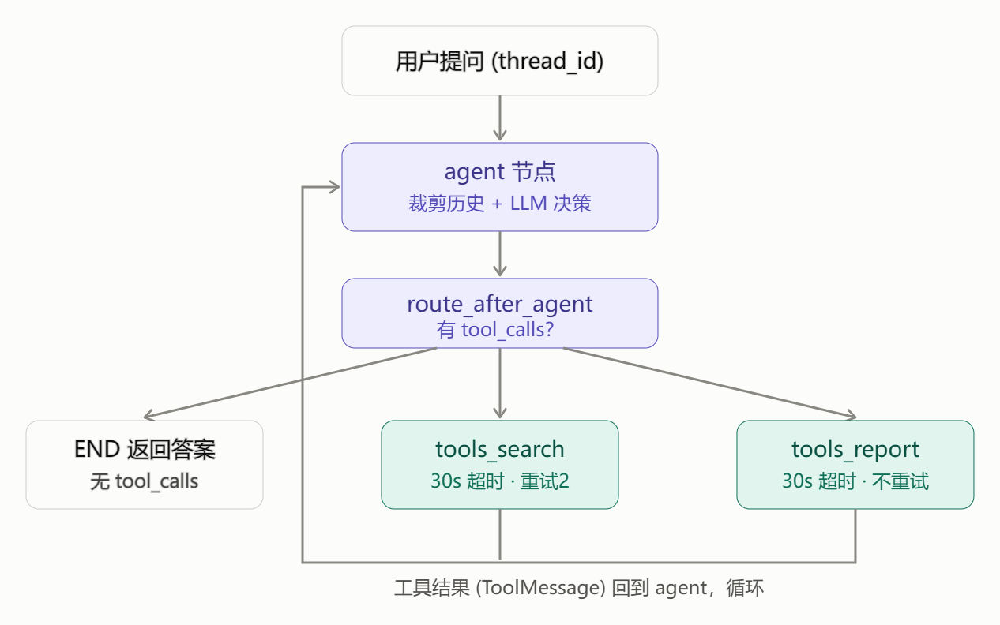
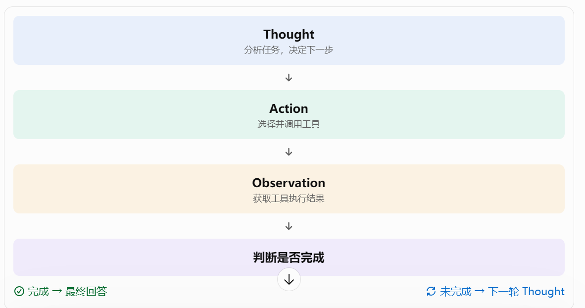

# Day 8｜Agent 与 ReAct

## 技术面试回答结构

1. 定义：它是什么？用自己的话解释概念
2. 目的：为什么需要它？理解它解决什么问题
3. 原理：它内部怎么工作？理解核心机制
4. 实践：我在项目中怎么使用？
5. 取舍：有什么局限，为什么选择它？

## 一、学习内容与记录

### 1. Agent 与普通 LLM 应用的区别

**定义：**

普通 LLM 应用通常是接收用户输入，将 **Prompt 和上下文**发送给模型，再返回模型生成的结果。

Agent 是一种能够根据任务目标，自主决定下一步操作，并通过调用工具、观察结果、继续执行来完成任务的**应用系统**。

**目的：**

普通 LLM 主要负责**文本理解和生成**，而 Agent 可以进一步操作外部工具、查询数据库、访问接口，完成**多步骤任务**。

**原理：**

典型 Agent 执行过程：
1. 接收用户任务。
2. 将任务和上下文交给 LLM。
3. LLM 判断是否需要调用工具。
4. 如果需要，**生成工具名称和参数**。
5. 系统执行工具并返回结果。
6. LLM 根据工具结果继续判断。
7. 任务完成后返回最终答案。

**实践：**
在 AI 资讯项目中，用户提出问题后，Agent 可以根据问题**选择新闻检索、语义检索或日报相关工具**，再根据工具返回的数据组织答案。
**局限与取舍：**

Agent 增加了**自主决策能力**，但也增加了**模型调用次数、执行延迟和不确定性**。对于固定的数据处理任务，直接使用普通 Python 函数或 Prefect 流程通常更可靠，不需要使用 Agent。

### 2. ReAct 是什么？

**定义：**

ReAct 是 Reasoning and Acting 的缩写，表示将**推理和行动**结合起来的一种 Agent 执行模式。

**目的：**

让模型不只是直接生成答案，还能根据当前信息决定是否需要调用工具，并利用工具结果继续完成任务。

**原理：**
ReAct 的核心过程是：
- Reasoning：分析当前任务，判断下一步应该做什么。
- Acting：执行具体动作，例如调用搜索工具。
- Observation：观察**工具返回的结果**，并作为下一轮决策的输入。
整个过程可以重复，直到任务完成。

**实践：**

例如用户询问“最近有哪些值得关注的大模型新闻？”
Agent 可以先判断需要查询新闻，再调用 `search_news` 或 `search_news_semantic`，根据返回结果组织回答。

**局限与取舍：**

ReAct 依赖**模型的判断能力**，可能出现工具选择错误、重复调用、推理偏离目标等问题。需要通过**工具约束**、执**行次数限制和错误处理**提高可靠性。

### 3. Thought、Action、Observation 的基本流程

**定义：**
- Thought：模型对当前任务和下一步操作的判断。
- Action：模型选择执行的动作，通常是调用某个工具。
- Observation：工具执行后返回的结果。

**目的：**

将模型的**决策过程和外部工具执行过程**连接起来，使 Agent 能够根据执行结果调整后续操作。

**原理：**

一个简化流程：
```text
用户问题
   ↓
Thought：判断需要查询新闻
   ↓
Action：调用 search_news
   ↓
Observation：返回新闻列表
   ↓
Thought：判断结果是否足够
   ↓
Action：必要时继续查询
   ↓
最终回答
```
实际框架中，Thought 不一定以完整文本形式暴露给用户，Action 通常体现为**结构化工具调用请求**。

**实践：**

结合项目，理解模型如何根据用户问题选择工具，以及工具返回结果如何重新传递给模型。

**局限与取舍：**

工具返回结果可能为空、格式错误或不完整。模型也可能错误理解 Observation，因此需要对工具返回值进行校验，并限制不必要的重复调用。

### 4. Agent 为什么需要循环？

**定义：**

Agent 循环是指模型完成一次决策或工具调用后，根据新的结果再次进行判断，直到满足结束条件。

**目的：**

复杂任务通常不能通过一次模型调用完成，需要多次检索、判断和工具执行。

**原理：**

典型循环：

```text
模型决策
   ↓
是否调用工具？
   ├── 是 → 执行工具 → 返回结果 → 再次决策
   └── 否 → 返回最终答案
```
每次工具执行都会产生新的 Observation，供模型下一轮使用。

**实践：**

AI 资讯项目中，Agent 可以先检索新闻，再根据检索结果判断是否需要获取日报。如果已有信息足够，就直接组织答案。

**局限与取舍：**

循环次数越多，**模型调用成本和延迟通常越高**。必须设置**最大执行轮数、超时和异常处理**，避免无限循环。

### 5. Agent 什么时候停止？

**定义：**

Agent 停止条件是判断当前任务是否已经完成、是否应该结束执行的规则。

**目的：**

避免 Agent 无限调用工具，同时保证任务完成后能够及时返回结果。

**原理：**

常见停止条件：
- 模型返回最终答案，不再请求工具。
- 达到最大执行轮数。
- 执行超时。
- 出现无法恢复的错误。
- 达到系统预设的终止条件。

**实践：**

在项目中，应关注 Agent 是否存在最大执行轮数、工具调用超时和异常退出机制。没有实际实现的限制不能在项目介绍中声称已经具备。

**局限与取舍：**

限制过严格可能导致**复杂任务尚未完成就停止**；限制过宽则可能造成**重复调用和成本增加**。需要根据任务复杂度设置合理边界。

### 6. 工具调用失败怎么办？

**定义：**

工具调用失败是指 Agent 请求外部工具后，工具**无法正常执行或无法返回有效结果**的情况。

**目的：**

让 Agent 在外部服务异常、参数错误或数据缺失时能够合理处理，而不是直接中断整个任务或编造结果。

**原理：**

常见处理方式：

1. 参数校验：检查工具输入是否符合 Schema。
2. 异常捕获：捕获工具执行过程中的异常。
3. 超时控制：避免工具长时间阻塞。
4. 有限重试：对临时性错误进行重试。
5. 错误反馈：将失败信息返回给 Agent。
6. 终止或降级：无法恢复时明确告知用户。

**实践：**

AI 资讯项目中，新闻检索工具可能出现无匹配结果、数据库异常或调用失败。需要区分正常的空结果和真正的执行错误，不能把二者混为一谈。

**局限与取舍：**

并非所有错误都适合重试。例如参数错误通常需要修正参数，而不是重复执行。对于非幂等操作，还需要避免重试造成重复写入。

## 二、实践任务

- 1. 画出 Agent 执行流程。
  
- 2. 结合项目讲解一次用户提问从进入系统到返回答案的过程。
- 3. 思考无限循环、工具超时、无结果等问题如何处理。

## 三、学习复盘

**今天还没搞懂的内容：**

- Agent 如何判断当前任务是否完成？
  Agent 的任务完成判断，是指 Agent 根据**用户目标、工具执行结果和当前上下文**，判断是否已经获得足够的信息并完成任务，决定继续调用工具还是结束执行。 
  Agent 通常通过 LLM 对当前上下文和工具执行结果进行判断，决定是否满足用户目标。如果已经获得足够的信息，就生成最终回答；如果还缺少信息，就继续调用工具。
   实际工程中不会完全依赖模型判断，还会设置最大执行步数、超时和错误次数等硬性约束，避免 Agent 无限执行。

- 如果模型一直选择调用工具，如何避免无限循环？+
   LLM 负责决策，程序负责兜底。
   常见有四种机制：
| 机制         | 作用                               |
| ------------ | ---------------------------------- |
| 最大执行步数 | 限制 Agent 最多执行多少轮          |
| 超时控制     | 限制整个任务的执行时间             |
| 重复调用检测 | 检测相同工具、相同参数是否反复调用 |
| 错误次数限制 | 连续失败达到阈值后停止             |

   为了避免 Agent 无限循环，我通常采用多层保护机制。首先设置**最大执行步数和整体超时时间**，其次检测重复工具调用，另外**限制连续失败次数**。当触发限制时，终止 Agent 循环，并返回当前已有结果或明确的失败信息。

- 工具调用失败后，Agent 应该重试、换工具，还是直接返回错误？
我会根据错误类型进行分层处理。对于**网络超时、服务端异常等临时性错误**，采用**有限次数重试**；对于**参数错误**，让模型根据错误信息修正参数；如果当前工具无法满足需求，可以尝试其他工具；如果属于**权限不足、数据不存在**等**不可恢复错误**，则直接返回明确错误。

同时需要设置重试次数和超时限制，避免反复调用造成资源浪费。
| 失败类型             | 推荐处理方式   | 示例                           |
| -------------------- | -------------- | ------------------------------ |
| 网络超时             | 有限重试       | API 暂时不可用                 |
| 服务端 5xx           | 有限重试       | 第三方服务异常                 |
| 参数错误             | 修正参数后重试 | 缺少必要参数                   |
| 工具不存在           | 重新选择工具   | 工具名称错误                   |
| 当前工具无法满足需求 | 尝试其他工具   | 关键词搜索无结果，尝试语义搜索 |
| 权限不足             | 返回错误       | 没有数据库访问权限             |
| 数据确实不存在       | 返回明确结果   | 指定日期没有日报               |

**需要面试前回顾的内容：**

- 1.普通 LLM 应用与 Agent 的核心区别是什么？
   普通 LLM 应用主要是接收用户输入，通过**模型推理直接生成结果**，执行流程通常比较固定。
   Agent 则是在 LLM 的基础上增加了**决策和执行机制**，能够根据用户目标**自主选择工具**，**根据工具返回结果调整下一步行动**，并通过**多轮循环**完成复杂任务。
   我自己的 AI News Agent 就是一个例子：用户提出新闻查询需求后，Agent 会判断使用关键词检索还是语义检索，调用对应的 MCP 工具，根据返回结果生成回答。
- 2.ReAct 中 Thought、Action、Observation 分别代表什么？完整执行流程是什么？
  ReAct 是一种结合推理和行动的 Agent 设计模式。Thought 表示模型对当前任务进行**分析和决策**；Action 表示模型**选择并发起工具调用**；Observation 表示**工具执行后返回的结果**。模型会根据 Observation 再次进行 Thought，决定下一步行动，直到满足任务完成条件并输出最终答案。

  ReAct = Reasoning + Acting，即推理与行动。
  它的核心思想是：**让模型在推理和执行之间交替进行，根据执行结果不断调整下一步决策。**
三个核心组成：
| 概念        | 含义 | 作用                             |
| ----------- | ---- | -------------------------------- |
| Thought     | 思考 | **分析**当前任务，**判断**下一步做什么   |
| Action      | 行动 | **选择**工具并**发起调用**               |
| Observation | 观察 | **获取**工具执行结果，作为**下一轮输入** |
- 3.Agent 为什么需要循环？
  因为复杂任务通常不能通过一次模型调用完成。
  Agent 需要循环，是因为复杂任务往往需要多个步骤才能完成，而且下一步决策依赖于前一步的执行结果。
  通过 Thought、Action、Observation 的循环，Agent 可以根据工具返回的信息**动态调整执行策略**，而不是按照固定流程执行。

  

- 4.停止条件通常如何设计？
  Agent 的停止条件通常分为**正常结束和异常终止**。
  正常情况下，当模型判断已经满足用户目标，就不再发起工具调用，而是生成最终回答。
  异常情况下，则通过最大执行步数、超时时间、错误次数和重复调用检测等机制终止执行。
  工程上一般采用**模型判断与程序规则**相结合的方式，既保证 Agent 的灵活性，又保证执行过程可控。

  停止条件可以分为两类：
第一类：正常停止条件
- 模型认为用户目标已经完成。
- 模型不再返回 Tool Call，转而生成最终回答。
- 工作流到达明确的结束节点。
第二类：异常停止条件
- 达到最大执行步数。
- 超过任务执行时间。
- 连续工具调用失败达到限制。
- 检测到重复调用或异常循环。
- 遇到不可恢复错误。

## 四、结合 AI News Agent
  ❗❗**主要是理解超时、重试等保障性实现，问题处理方式**

  **Agent 是单 Agent + Tool Calling 架构，通过 LangGraph 实现循环，通过 FastMCP 提供工具，通过 ToolNode 执行工具。**
 
目前代码已经实现了**工具分组、工具超时、有限重试、上下文裁剪、执行递归限制**等机制。不过，无结果处理、重复调用检测和独立的总执行时间限制还不够完善。这些要区分已经实现的功能和后续可以优化的功能，面试时不要把计划中的功能说成已经实现。

| 面试知识点  | 在项目中对应的实现             |
| ----------- | ------------------------------ |
| Thought     | Agent LLM 根据上下文决定下一步 |
| Action      | 模型返回 Tool Call             |
| 工具执行    | FastMCP 工具调用               |
| Observation | 工具返回的新闻数据             |
| 循环        | LangGraph Agent 执行流程       |
| 正常停止    | 模型不再返回 Tool Call         |
| 异常停止    | 最大步数、超时、错误处理       |
| 重试        | 模型调用重试、工具调用异常处理 |

1. Tool Calling 不等于 Agent。 普通 LLM 应用也可以调用工具，Agent 更强调根据执行结果自主决定后续步骤。
2. ReAct 不等于 LangGraph。 ReAct 是一种执行模式，LangGraph 是可以用来实现这种模式的工作流框架。
3. 模型判断完成不等于程序允许继续。 模型可以提出继续调用，但程序仍然可以通过执行限制终止任务。

问题 1：画出并讲解你的 Agent 执行流程
参考回答：
我的项目采用单 Agent + Tool Calling 架构，基于 LangGraph 构建执行流程，通过 FastMCP 提供外部工具。
整体执行过程是：
1. 用户通过 FastAPI 提交问题，后端将问题封装成 **HumanMessage**。
2. 进入 LangGraph 的 agent_node，结合 System Prompt 和历史消息调用 LLM。
3. LLM 根据用户需求和工具描述决定是否调用工具，并返回 Tool Call。
4. route_after_agent 根据 Tool Call 进行条件路由，将不同工具分发到对应的工具组。
5. ToolNode 负责执行工具，搜索类工具和日报类工具分别由不同节点处理。
6. 工具执行结果封装成 ToolMessage，作为 Observation 返回给 Agent。
7. Agent 再次调用 LLM，根据工具结果决定继续调用工具还是生成最终回答。
8. 当模型不再返回 Tool Call 时，通过 END 结束执行。
其中 LangGraph 负责流程编排和状态管理，LLM 负责决策，ToolNode 负责工具执行，MCP 负责统一工具接入。

问题 2：如果 Agent 一直调用工具，怎么避免无限循环？
参考回答：
我会采用模型判断与程序控制相结合的方式。
正常情况下，模型根据工具返回结果判断任务是否完成，如果不需要继续调用工具，就生成最终回答。
但是模型的判断并不完全可靠，因此工程上还需要增加限制。
我的项目已经设置了 LangGraph 的 recursion_limit、工具组超时、RetryPolicy，以及工具返回结果长度限制。
进一步优化的话，我会增加独立的最大工具执行轮数、整体任务超时、重复工具调用检测和连续失败次数限制。
当达到这些限制时，不再允许继续调用工具，而是通过结束节点整理已有结果，并向用户返回最终答案或明确的失败信息。
 
问题 3：工具调用失败、超时或者没有结果，怎么处理？
参考回答：
我会先区分工具执行失败和正常无结果。
如果是网络超时等临时性错误，可以进行有限次数重试；如果是参数错误，可以根据错误信息修正参数；如果当前工具无法满足需求，可以尝试其他工具。
如果工具正常执行但没有检索到数据，则不应该当作异常处理，可以尝试调整查询条件或使用语义检索等替代方式。如果仍然没有结果，就明确告知用户没有检索到相关信息。
对于无法恢复的错误，例如权限不足、服务持续不可用，则直接返回明确的错误信息。
同时需要限制重试次数、工具执行时间和 Agent 总执行时间，避免无限循环和资源浪费。