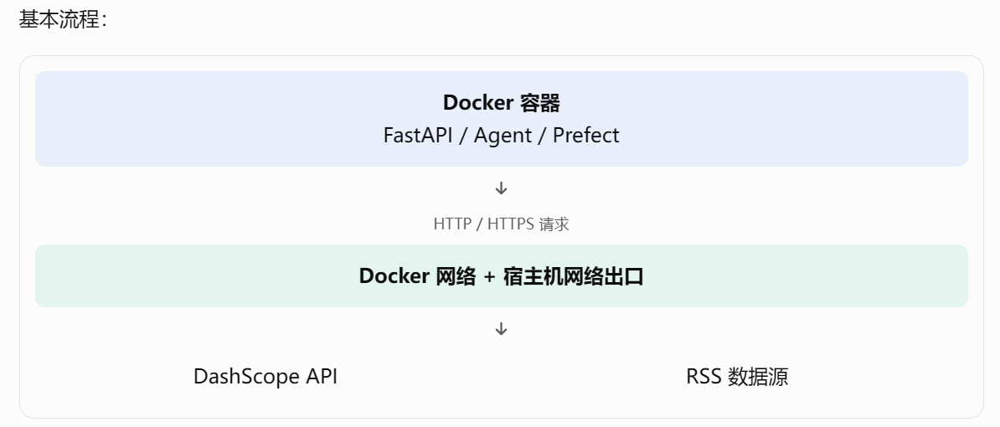

# Day 11｜Prefect、Docker 与工程化

## 技术面试回答结构

1. 定义：它是什么？用自己的话解释概念
2. 目的：为什么需要它？理解它解决什么问题
3. 原理：它内部怎么工作？理解核心机制
4. 实践：我在项目中怎么使用？
5. 取舍：有什么局限，为什么选择它？

## 一、学习内容与记录

### 1. Prefect 的 Flow、Task、重试、调度

**定义：**

Prefect 是一个 **Python 工作流编排和调度框架**。

- Flow：表示一个完整的工作流，负责组织任务执行。
- Task：表示工作流中的一个具体任务。
- 重试：任务失败后按照配置重新执行。
- 调度：按照指定时间或触发条件启动工作流。

**目的：**

将复杂的数据处理流程拆分成多个任务，统一管理执行顺序、任务状态、日志和失败重试。

**原理：**

Prefect 通过**装饰器**将普通 Python 函数定义为 Flow 或 Task。

```python
from prefect import flow, task

@task(retries=3, retry_delay_seconds=60)
def fetch_data():
    return ["news1", "news2"]

@task
def process_data(data):
    return [item + "_processed" for item in data]

@flow
def daily_pipeline():
    data = fetch_data()
    result = process_data(data)
    return result

if __name__ == "__main__":
    daily_pipeline()
```

Flow 负责**组织任务执行**，Task 负责执行**具体业务逻辑**。

当 Task 失败时，Prefect 根据配置决定是否重试。

调度则通过 **Prefect 的部署和调度配置**，按照指定时间触发 Flow。

**实践：**

AI 资讯项目使用 Prefect 管理 **RSS 采集、正文抽取、去重、LLM 分析和向量入库**等数据处理步骤。

项目中有：

- `daily-news-pipeline`
- `batch-daily-news-pipeline`
- `news-update-pipeline`

其中 `daily-news-pipeline` 用于每日新闻处理流程。

**局限与取舍：**

Prefect 适合有明确执行顺序、需要调度和重试的数据流程，但它不是 Agent 框架。

重试也不能解决所有错误。对于参数错误、数据格式错误等确定性问题，重复执行通常没有意义。

### 2. Prefect 与 LangGraph 的职责边界

**定义：**

Prefect 主要负责数据工作流的编排、调度和任务管理。

LangGraph 主要负责有状态的 Agent 工作流，包括节点执行、条件路由和工具调用。

**目的：**

将确定性较强的数据处理任务与需要模型动态决策的智能任务分开管理。

**原理：**

Prefect 更关注：

- 任务什么时候执行。
- 任务按照什么顺序执行。
- 任务失败后如何重试。
- 工作流当前执行到什么状态。

LangGraph 更关注：

- Agent 如何**理解用户请求**。
- 下一步应该执行哪个节点。
- 是否需要调用工具。
- 工具结果如何影响下一步决策。

整体关系：

```text
Prefect 数据处理层
   ↓
RSS 采集
   ↓
正文抽取
   ↓
LLM 分析
   ↓
去重与 Embedding
   ↓
数据库和向量库
   ↓
LangGraph Agent 层
   ↓
用户提问
   ↓
工具选择与调用
   ↓
返回答案
```

**实践：**

AI 资讯项目中，Prefect 负责 RSS 新闻采集和数据处理等确定性任务。

LangGraph 负责用户查询时的 Agent 工具调用，由模型根据问题选择新闻检索或日报相关工具。

**局限与取舍：**

两者解决的问题不同，不需要互相替代。

如果将所有数据处理都交给 Agent，会增加执行的不确定性；如果将所有动态决策都写成固定流程，又会降低灵活性。

因此，项目采用 Prefect 管理**数据流水线**，LangGraph 管理 Agent **查询流程**。

### 3. Docker 镜像、容器、Dockerfile

**定义：**

- Dockerfile：描述**如何构建 Docker 镜像的配置文件**。
- Docker Image：镜像，包含**应用运行所需的文件和环境**。
- Docker Container：容器，是镜像启动后形成的**运行实例**。

**目的：**

将**应用代码**、**运行环境和依赖**打包，减少不同机器之间的环境差异，方便部署和运行。

**原理：**

基本流程：

```text
Dockerfile
    ↓ docker build
Docker Image
    ↓ docker run
Docker Container
    ↓
应用运行
```

一个简单 Dockerfile：

```dockerfile
FROM python:3.11-slim
WORKDIR /app
COPY requirements.txt .
RUN pip install --no-cache-dir -r requirements.txt
COPY . .
CMD ["python", "main.py"]
```
构建镜像：
```bash
docker build -t ai-news-agent .
```
启动容器：
```bash
docker run -p 8000:8000 ai-news-agent
```
**实践：**

AI 资讯项目可以通过 Docker 部署 FastAPI 服务，将 Python 运行环境、依赖和启动命令统一配置。
需要理解项目 Dockerfile 中的基础镜像、工作目录、依赖安装、文件复制和启动命令。

**局限与取舍：**

Docker 可以**减少环境差异**，但不能自动保证应用稳定。

**数据库持久化、环境变量、网络通信、日志和资源限制仍然需要单独配置**。

镜像过大也会增加构建和分发成本，需要合理选择基础镜像和依赖。

### 4. 日志、异常处理、超时、重试⭐

**定义：**

- 日志：记录程序运行过程、关键操作和异常信息。
- 异常处理：捕获并处理程序运行过程中出现的错误。
- 超时：限制某项操作允许执行的最长时间。
- 重试：操作失败后再次执行。

**目的：**

提高系统的**可观测性和稳定性**，帮助开发者定位问题，避免外部服务异常导致整个流程长时间阻塞。

**原理：**

日志可以记录程序运行状态：

```python
import logging
logging.basicConfig(level=logging.INFO)
logging.info("开始执行新闻采集")
```

**异常处理可以使用 try-except：**

```python
try:
    result = fetch_data()
except TimeoutError:
    logging.error("请求超时")
except Exception as exc:
    logging.exception("任务执行失败")
    raise
```

超时可以限制外部请求的执行时间。
重试可以针对临时性错误进行有限次数的再次执行。

常见异常包括：

- 网络连接失败。
- 外部 API 超时。
- 数据格式错误。
- 数据库连接异常。
- 模型调用失败。

**实践：**

AI 资讯项目中，需要关注：

- RSS 源访问失败。
- 正文抽取失败。
- LLM API 调用超时。
- Embedding 接口异常。
- SQLite 或 Chroma 写入失败。

Prefect 可以管理任务状态和配置重试，具体业务代码仍需要处理异常和记录日志。

**局限与取舍：**

不是所有错误都应该重试。

例如：

- 网络临时故障：可以考虑重试。
- 参数错误：应该修正参数。
- 数据格式错误：应该检查数据。
- 数据库重复写入：需要考虑幂等性。

重试次数过多会增加延迟和资源消耗，还可能导致重复操作。

### 5. FastAPI 服务如何部署和运行？

**定义：**

FastAPI 是一个**基于 Python 的 Web 框架**，可以通过**定义路由和数据模型**构建 HTTP API 服务。

部署是将开发完成的服务运行在目标环境中，并让客户端能够通过网络访问。

**目的：**

将项目中的业务能力封装为 HTTP 接口，使前端或其他服务能够调用。

**原理：**

一个简单 FastAPI 服务：
```python
from fastapi import FastAPI
app = FastAPI()
@app.get("/health")
def health():
    return {"status": "ok"}
@app.get("/news")
def get_news(keyword: str):
    return {
        "keyword": keyword,
        "items": []
    }
```
启动服务：
```bash
uvicorn main:app --host 0.0.0.0 --port 8000
```

参数含义：

- `main`：Python 模块名。
- `app`：FastAPI 应用实例。
- `--host 0.0.0.0`：监听所有网络接口。
- `--port 8000`：监听 8000 端口。

运行后，客户端可以通过 HTTP 请求访问接口，FastAPI 负责接收请求、执行对应业务逻辑并返回响应。

**实践：**

AI 资讯项目采用 FastAPI 作为后端服务，向 Next.js 前端提供新闻查询和相关业务接口。

整体调用关系：

```text
用户
  ↓
Next.js 前端
  ↓ HTTP 请求
FastAPI
  ↓
业务逻辑 / 数据库 / Agent
  ↓
返回 JSON
  ↓
前端展示
```
如果使用 Docker 部署，可以将 FastAPI 服务及其依赖构建为镜像，再通过容器运行。

**局限与取舍：**

FastAPI 主要**解决 Web API 服务开发问题**，不负责完整的数据工作流调度，也不负责 Agent 的决策逻辑。

部署时还需要考虑：

- 环境变量和密钥管理。
- 数据库连接。
- 服务端口和网络。
- 日志和异常处理。
- 服务进程管理。
- 容器数据持久化。

## 二、实践任务

- [ ] 找到项目中的 Prefect Flow 和 Task。
- [ ] 解释新闻采集失败后如何重试。
- [ ] 梳理从数据采集到 Agent 服务的部署流程。
- [ ] 检查 Docker 配置，理解各个服务之间的关系。

## 三、学习复盘

**今天还没搞懂的内容：**

- Prefect 的 Task 失败后，任务状态和重试机制是如何工作的？
  
    Prefect 提供了任务状态管理和失败重试机制。我在项目中对新闻采集、数据处理等任务配置了**最多 3 次重试**，每次间隔 60 秒。当外部 RSS 请求出现暂时性网络异常时，可以自动重试。如果多次重试仍然失败，就会将任务标记为 Failed，并通过日志定位问题，避免单次网络波动导致整个数据处理流程直接中断。
    1.1 Task 的执行状态：Prefect 会跟踪每个 Task 的执行状态。

    | 状态      | 含义           |
    | --------- | -------------- |
    | Pending   | 等待执行       |
    | Running   | 正在执行       |
    | Completed | 执行成功       |
    | Failed    | 执行失败       |
    | Retrying  | 失败后等待重试 |
    | Cancelled | 任务被取消     |

    1.2 重试机制
    例如，你的新闻采集任务需要调用 RSS 数据源：
    1. 第一次请求 RSS，发生网络超时。
    2. Prefect 捕获任务异常，判断是否允许重试。
    3. 如果配置了 retries=3，就会进行重试。
    4. 重试成功，Task 状态变为 Completed。
    5. 如果重试次数耗尽，最终状态变为 Failed。
    注意：retries=3 通常表示首次执行之外，还允许重试 3 次，总共最多执行 4 次。


- Docker 容器如何访问外部服务？SQLite 和 Chroma 数据如何保证持久化？
  Docker 容器可以通过网络访问外部服务。

2.2 SQLite 和 Chroma 如何持久化？
**核心概念：Docker Volume（数据卷）和 Bind Mount（目录挂载）。**
Docker 容器删除后，容器内部没有挂载的数据可能丢失。
所以不能只把数据库文件放在容器内部，而应该**将宿主机目录挂载到容器内部**。

Docker 容器默认有自己的文件系统，如果容器删除，内部未持久化的数据可能丢失。因此我的项目会通过目录挂载，将**宿主机的 storage 目录映射到容器内部**，SQLite 和 Chroma 都统一存放在这个目录下。这样即使容器重新创建，数据库文件和向量数据也不会丢失。

- FastAPI 服务、Prefect 流程和 Agent 服务之间如何划分职责？
  
    我把三个组件按照职责进行了划分。
    FastAPI 主要负责对外提供接口，处理前端请求和服务调用；Prefect 负责管理离线数据处理流程，比如新闻采集、清洗、去重、向量化和日报生成；LangGraph 负责在线 Agent 的推理和工具调用。
    这样划分可以降低模块之间的耦合。比如数据采集任务失败，不需要影响 Agent 的执行框架；Agent 的工具调用逻辑发生变化，也不需要修改整个新闻采集流程。

    | 组件            | 核心职责           | 项目中的具体工作                                |
    | --------------- | ------------------ | ----------------------------------------------- |
    | FastAPI         | 对外提供 HTTP 接口 | 接收前端请求、返回新闻、处理聊天请求            |
    | Prefect         | 管理数据处理工作流 | RSS 采集、清洗、去重、分析、Embedding、日报生成 |
    | LangGraph Agent | 管理智能体执行过程 | 理解用户问题、选择工具、执行检索、组织回答      |

**需要面试前回顾的内容：**

- Prefect 的 Flow、Task、重试和调度分别是什么？
  
  Prefect 是一个 Python 工作流编排工具。
  
  Flow 表示整个工作流，Task 表示工作流中的具体任务。通过 Flow 可以组织多个 Task 的执行顺序和依赖关系，同时提供任务状态管理、失败重试和定时调度能力。
  
  在我的项目中，我使用 Prefect 管理新闻处理 Pipeline，将 RSS 采集、清洗、去重、LLM 分析、Embedding 和日报生成拆分成不同任务，并配置重试机制和定时执行。

- 为什么项目使用 Prefect 管理数据处理，而使用 LangGraph 管理 Agent？
  
  主要是因为两者解决的问题不同。
  Prefect 更适合管理确定性的数据处理流程，比如我的新闻采集、清洗、去重、Embedding 和日报生成，这些任务执行顺序相对固定，而且需要定时调度、失败重试和状态跟踪。
  LangGraph 更适合管理 Agent 的动态执行过程，比如理解用户问题、判断是否调用工具、选择不同的 MCP Tool，以及根据工具结果继续推理。
  所以我使用 Prefect 管理数据 Pipeline，使用 LangGraph 管理在线 Agent，二者各司其职。

  核心区别：Prefect 管理确定性的任务流程，LangGraph 管理具有动态决策能力的 Agent 流程。

| 对比     | Prefect              | LangGraph                |
| -------- | -------------------- | ------------------------ |
| 核心定位 | 工作流编排           | Agent 编排               |
| 主要用途 | 数据处理、ETL        | 智能体推理和工具调用     |
| 执行方式 | 按照预设任务流程执行 | 根据模型决策动态执行     |
| 流程控制 | Task 依赖、任务调度  | 节点、边、条件边         |
| 状态管理 | 任务执行状态         | Agent 对话和执行状态     |
| 典型场景 | 新闻采集、清洗、入库 | 理解问题、选择工具、回答 |

- Docker 镜像、容器和 Dockerfile 有什么区别？    Dockerfile 是构建镜像的配置文件，描述应用需要什么环境和依赖；镜像是根据 Dockerfile 构建出来的运行模板；容器是镜像启动之后产生的运行实例。
- 外部 API 调用失败时，如何结合日志、异常、超时和重试进行处理？
  
  在项目中调用外部 API 时，我主要从四个方面保证稳定性。
  第一是日志记录，记录请求接口、执行耗时和异常信息；第二是异常捕获，避免单次请求失败导致整个程序崩溃；第三是设置超时时间，避免请求长时间阻塞；第四是针对网络异常和服务端临时错误配置有限次数的重试，并使用指数退避降低频繁请求的影响。
  对于参数错误、认证失败等不可恢复异常，不会盲目重试，而是记录日志并进行问题定位。

- FastAPI 服务如何启动？如何通过 Docker 部署？
  
  我的 FastAPI 服务使用 Uvicorn 作为 ASGI 服务器启动，通过 uvicorn main:app 指定入口文件和 FastAPI 实例。
  部署时，我会编写 Dockerfile，指定 Python 基础镜像、安装项目依赖、复制代码，并通过 CMD 配置启动命令。之后使用 docker build 构建镜像，再使用 docker run 启动容器，通过端口映射将容器内部的 8000 端口暴露给外部访问。同时通过 Volume 挂载持久化数据库和向量数据，通过环境变量管理 API Key 等配置信息。

需要进一步核对技术细节时，优先看官方文档：
- Prefect Tasks：任务状态与重试https://github.com/PrefectHQ/prefect/blob/main/docs/v3/concepts/tasks.mdx?utm_source=chatgpt.com
- Prefect Task API：重试参数https://reference.prefect.io/prefect/tasks/?utm_source=chatgpt.com
- Docker Volumes：数据持久化https://docs.docker.com/engine/storage/volumes/?utm_source=chatgpt.com
- FastAPI Docker 部署https://fastapi.tiangolo.com/deployment/docker/?utm_source=chatgpt.com